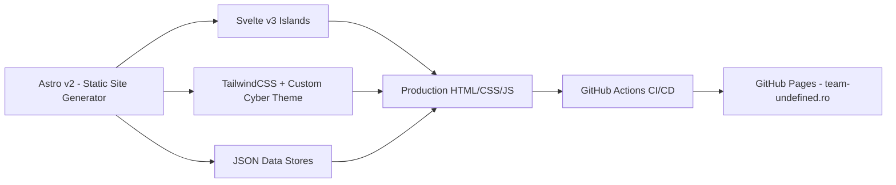

<div align="center">

  

  # 🤖 Team Undefined — Official Website
  ### *FIRST* Tech Challenge Team #19112 • Câmpina, Romania

  [](https://team-undefined.ro)
  [](https://www.firstinspires.org/robotics/ftc)
  [](https://astro.build)
  [](https://svelte.dev)
  [](https://tailwindcss.com)
  [](https://team-undefined.ro)

  <p align="center">
    <b>"WE CAN BE ANYTHING"</b><br/>
    <i>Design. Build. Code. Redefine.</i>
  </p>

  <p align="center">
    <a href="#-about-team-undefined">About</a> •
    <a href="#-key-features">Key Features</a> •
    <a href="#-robot-hall-of-fame">Robots</a> •
    <a href="#-tech-stack--architecture">Tech Stack</a> •
    <a href="#-project-structure">Project Structure</a> •
    <a href="#-getting-started">Getting Started</a> •
    <a href="#-content-management">Content Management</a> •
    <a href="#-connect-with-us">Connect</a>
  </p>

</div>

---

## 🌟 About Team Undefined

**Team Undefined (#19112)** is a high school robotics team founded at **Colegiul Național „Nicolae Grigorescu”** in Câmpina, Prahova, Romania, competing in the worldwide **FIRST® Tech Challenge (FTC)** program. 

Our official website at [team-undefined.ro](https://team-undefined.ro) serves as our digital headquarters. It is engineered from the ground up to reflect our cyberpunk and robotic identity, providing our community, corporate sponsors, judges, and aspiring team members with:

- 🏆 **Season Journeys & Results**: Comprehensive competition logs, awards, and team history.
- 🦾 **Robotics Portfolio**: Detailed CAD models, high-performance mechanical breakdowns, code features, and reveal videos.
- 👥 **Team Roster**: Multi-season member directory spanning mechanics, programming, 3D design, electronics, and marketing.
- 🤝 **Sponsorship & Crowdfunding**: Transparent partnership tiers, wishlist hardware, and direct support channels.

---

## 🚀 Key Features

### ⚡ Blazing Fast Islands Architecture
Powered by [Astro](https://astro.build) and [Svelte](https://svelte.dev), the website generates static HTML with zero client-side JavaScript overhead by default, hydrating interactive Svelte components (image carousels, lightbox galleries, dynamic filter tabs) only when needed.

### 🛸 Cyberpunk Aesthetic & Interactive Kinetic Easter Eggs
The site features custom procedural canvas and DOM animations that bring our robotic universe to life:
- **Wall-E Style Robot Walker**: An animated rover patrolling the footer across all pages with mechanical tracks, blinking antenna sensors, and randomized autonomous wandering.
- **Autonomous Drone**: A procedural quadcopter flying across Bezier trajectory curves over the hero screen.
- **Alien UFO & Interactive Tractor Beam**: A flying saucer that patrols the sky and fires a tractor beam whenever aligned with the ground rover, triggering emergency police strobe animations.

### 🤖 High-Definition Robot Showcase
Full-featured gallery with responsive CAD render viewing, specifications, match highlights, and an interactive full-screen Lightbox with keyboard navigation (`←`, `→`, `ESC`).

### 📦 Dynamic Data-Driven Content
Team members, sponsors, partners, and equipment wishlists are cleanly decoupled into structured JSON configurations, allowing quick updates without touching markup or styles.

---

## 🦾 Robot Hall of Fame

| Season | Robot Name | Challenge | Key Innovations & Highlights |
| :--- | :--- | :--- | :--- |
| **2026** | **BIOBUZZ** *(Reveal Incoming)* | *BIOBUZZ™* | Nature-inspired kinematics, next-gen autonomous routine, modular architecture. |
| **2025** | **BOTZILLA** | *DECODE* | Continuous turret tracking (270°), 4-sensor color indexing, compact 550 RPM drivetrain, parallel task execution. |
| **2024** | **VIK** | *INTO THE DEEP* | Submersible sample intake, ultra-precise odometry localization, high-speed active transfer. |
| **2023** | **FRANK** | *CENTERSTAGE* | Dual-stage linear slide, precision pixel placement system, drone launcher integration. |
| **2022** | **AL ABDULAH** | *POWERPLAY* | Custom high-speed junction aligner, multi-level cone stacking gripper, rigid mast design. |
| **2021** | **BOBILDA** | *ULTIMATE GOAL / KICKOFF* | High-velocity ring flywheel shooter, angled intake hopper, wobble goal gripper. |

---

## 🛠️ Tech Stack & Architecture



- **Framework**: [Astro v2.10](https://astro.build/) — Zero-JS static site generation
- **Component UI**: [Svelte v3.55](https://svelte.dev/) — Reactive client islands
- **Styling**: [TailwindCSS v3.2](https://tailwindcss.com/) + Custom CSS animations and clip-path geometry
- **Typography**: `Orbitron` (Cyberpunk headers) & `Rajdhani` / `Space Grotesk` (Technical body copy)
- **Icons**: [svelte-feather-icons](https://github.com/davedbase/svelte-feather-icons)
- **Carousel Engine**: [Siema](https://pawelgrzybek.github.io/siema/)
- **Hosting & CI/CD**: GitHub Pages via automated GitHub Actions deployment workflow

---

## 📁 Project Structure

```text
undefined-website/
├── public/                       # Static public assets
│   ├── img/
│   │   ├── home/                 # Hero carousel images
│   │   ├── members/              # Team member headshots
│   │   ├── robots/               # CAD renders & photos by robot
│   │   ├── sponsor/              # Sponsor logos
│   │   └── parts/                # Donation catalog hardware
│   ├── logo_undefined_white.svg  # Vector brand logo
│   └── favicon.svg               # Site favicon
├── src/
│   ├── components/               # Svelte & Astro UI components
│   │   ├── AboutUs.svelte        # Story, FTC Core Values, dynamic year browser
│   │   ├── Carousel.svelte       # Hero image slider
│   │   ├── DonateSection.svelte  # Donation tiers, IBAN, parts list
│   │   ├── Footer.svelte         # Responsive cyber footer
│   │   ├── Navbar.svelte         # Fixed navigation with mobile drawer
│   │   ├── SponsorList.svelte    # Sponsorship packages & equipment wishlist
│   │   ├── members.json          # Roster database organized by year
│   │   ├── sponsors.json         # Current sponsor directory
│   │   ├── partners.json         # Institutional & community partners
│   │   └── parts.json            # Equipment wishlist catalog
│   ├── layouts/
│   │   └── Layout.astro          # Root layout with SEO, analytics, & rover walker
│   ├── pages/                    # Astro routing
│   │   ├── index.astro           # Homepage with hero & kinetic animations
│   │   ├── team/                 # Team members & achievements
│   │   │   ├── apply/            # Team recruitment application
│   │   │   └── sponsors/         # Sponsorship guide & partner wall
│   │   ├── robots/               # Robot showcase & lightbox gallery
│   │   ├── donate/               # Financial donations & hardware wishlist
│   │   └── contact/              # Contact cards, phone, shipping address
│   └── styles/
│       └── base.css              # Cyber theme, keyframes, neon effects, typography
├── astro.config.mjs              # Astro configuration (Svelte, Tailwind)
├── tailwind.config.cjs           # Tailwind theme extensions & custom variables
└── package.json                  # Dependencies and scripts
```

---

## 💻 Getting Started

### Prerequisites

- [Node.js](https://nodejs.org/) (v18.x or higher recommended)
- `npm` (bundled with Node) or `pnpm` / `yarn`

### Installation

1. **Clone the repository:**
   ```bash
   git clone https://github.com/andwe1n/undefined-website.git
   cd undefined-website
   ```

2. **Install dependencies:**
   ```bash
   npm install
   ```

3. **Start the local development server:**
   ```bash
   npm run dev
   # or with custom port:
   npm run dev -- --port 9919
   ```

4. Open `http://localhost:3000` (or your assigned port) in your browser.

### Build & Production Preview

```bash
# Compile optimized static bundle to dist/
npm run build

# Preview production build locally
npm run preview
```

---

## 📝 Content Management

Updating site content is straightforward thanks to centralized JSON data sources:

### Adding or Updating a Team Member
Edit `src/components/members.json`:
```json
{
  "2026": [
    {
      "src": "/img/members/alex_popescu.jpg",
      "name": "Alex Popescu",
      "department": "Programming",
      "desc": "Autonomous trajectory planning and computer vision lead."
    }
  ]
}
```

### Adding a New Sponsor
Edit `src/components/sponsors.json`:
```json
{
  "name": "Acme Robotics",
  "logo": "/img/sponsor/acme.png",
  "link": "https://acme-robotics.example",
  "tier": "platinum"
}
```

### Adding Parts to the Wishlist
Edit `src/components/parts.json`:
```json
{
  "name": "goBILDA 5203 Series Yellow Jacket Planetary Gear Motor",
  "price": "45$",
  "img": "/img/parts/gobilda-motor.jpg",
  "link": "https://www.gobilda.com/..."
}
```

---

## 🎨 Design System

| Element | Specification | Visual Role |
| :--- | :--- | :--- |
| **Primary Accent** | `#519259` / `rgb(81, 146, 89)` | Glowing borders, neon highlights, interactive focus states |
| **Bright Green** | `#22c55e` / `rgb(34, 197, 94)` | Badges, call-to-actions, active indicators |
| **Dark Canvas** | `#0a0a0a` to `#121212` | Deep space background gradients |
| **Card Surface** | `#181818` with `rgba(255, 255, 255, 0.04)` | Translucent glassmorphism containers |
| **Headings** | `'Orbitron', monospace` | Heavy-weight uppercase futuristic typography |
| **Body Text** | `'Rajdhani', sans-serif` | Clean technical reading font |
| **Geometric Cut** | `clip-path: polygon(...)` | Chamfered robotic corners on cards and buttons |

---

## 🤝 Connect with Us

Have questions, want to partner with us, or support our journey to the FIRST World Championship? We would love to hear from you!

- 🌐 **Website**: [team-undefined.ro](https://team-undefined.ro)
- 📧 **Email**: [teamundefined2021@gmail.com](mailto:teamundefined2021@gmail.com)
- 📸 **Instagram**: [@team_undefined](https://www.instagram.com/team_undefined/)
- 📘 **Facebook**: [Team Undefined](https://www.facebook.com/teamundefinedcnng/)
- 🎥 **YouTube**: [Team Undefined Channel](https://www.youtube.com/channel/UCN4OeYg_hz3U1jyXbdKV9cw)
- 📍 **Headquarters**: Colegiul Național „Nicolae Grigorescu”, Calea Doftanei 4, Câmpina 105600, Prahova, Romania

---

<div align="center">
  <sub>Built with ❤️ and 🤖 by <b>Team Undefined (#19112)</b>. Code released under the MIT License.</sub>
</div>
